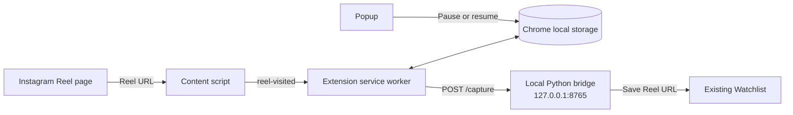

# Instagram Watchlist browser capture

This Chrome extension notices when the active Instagram.com page moves to a Reel and sends that Reel URL to the existing local Watchlist. It does not read the video, captions, messages, or password. Capture can be paused from the extension popup.

## Data flow



## Start the local helper

In Terminal, run:

```sh
"/Users/niravs/.virtualenvs/instagram-watchlist312/bin/python" "/Users/niravs/Documents/Codex/2026-10-18/referenced-chatgpt-conversation-this-is-an/outputs/instagram-watchlist-browser-capture/watchlist_bridge.py"
```

Leave that Terminal window open while browsing. Press **Control+C** there to stop capture.

## Load the extension in Chrome

1. Open `chrome://extensions`.
2. Turn on **Developer mode**.
3. Choose **Load unpacked**.
4. Select this `instagram-watchlist-browser-capture` folder.
5. Accept Chrome's extension notice and pin **Instagram Watchlist Capture** if desired.
6. Open or reload Instagram.com. When you navigate to a Reel, its link is saved to the local Watchlist.

The extension asks Chrome to run on Instagram.com and contact `127.0.0.1:8765`. It captures `/reel/<id>` and `/reels/<id>` URLs. Repeated visits are deduplicated by the existing watchlist database. Use the extension popup to pause or resume capture.

## Limitations

- Works with Instagram.com in desktop Chrome; it does not monitor Instagram's iPhone app.
- Captures every Reel page you visit while enabled, without filtering by whether you watched it.
- Does not download video or collect captions, creators, recommendations, or other page content.
- The local helper uses the existing `server.py` path and database location. Set `IG_WATCHLIST_SERVER` if the server file is elsewhere.
